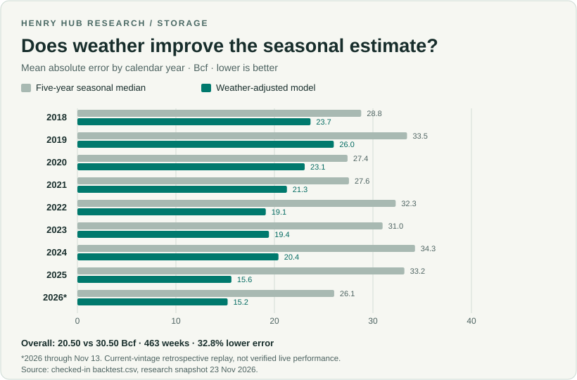

# Natural Gas Research Notes

**John Barreto · 23 November 2026 edition**

How much does observed temperature improve an estimate of U.S. gas storage? And when the Henry Hub futures curve falls, how differently can two delivery months move? These two notes publish the observations and calculations behind each answer.

[Read the illustrated edition](https://neurax-jb.github.io/natural-gas-research-notes/) · [John Barreto’s portfolio](https://github.com/NeuraX-JB)

## Choose a study

| Study | What the evidence shows |
| --- | --- |
| [001 · Weather and weekly storage](lab/research/storage-weather.md) | Across 463 Lower 48 weeks, adding observed heating and cooling degree days reduced the average absolute miss from 30.50 to 20.50 billion cubic feet (Bcf). The weather model was closer on 266 weeks and the five-year seasonal median was closer on 197. |
| [002 · Henry Hub delivery months](lab/research/curve-repricing.md) | Between 30 June and 30 September 2026, all nine matched contracts fell. January 2027 fell $0.639 per million Btu and July 2027 fell $0.160. The January premium over July narrowed by $0.479 per million Btu. |

### Read the storage result

The replay covers 5 January 2018 through 13 November 2026. It uses national observed weather and current-vintage data. Historical release timing is unverified for some inputs, and the edition contained zero completed, scored live forecasts. The chart groups weeks by calendar year, with 46 weeks in 2026. [Annual results and interval coverage](lab/research/storage-weather.md#question-and-result) · [Two individual weeks](lab/research/storage-weather.md#two-weeks-from-the-replay)

### Read the curve result

The comparison holds each delivery month fixed between two observations reconstructed from SEC filings. It measures how much each contract moved. Identifying why it moved would take additional evidence. [Nine prices and filing references](lab/research/curve-repricing.md#matched-contracts-and-recorded-provenance) · [January–July spread calculation](lab/research/curve-repricing.md#how-the-january-premium-over-july-changed)

## Check or cite the evidence

The notes use the [23 November edition’s frozen evidence revision](https://github.com/NeuraX-JB/Henry-Hub-Futures-Curve-Explorer-How-the-Natural-Gas-Market-prices-winter/tree/ba3b94ba3a97c3262099da73a25a3a33f06c34ee) of the original research lab. The [reproduction guide](lab/research/REPRODUCE.md) checks the published arithmetic against that revision. [Source definitions](lab/data/README.md) explain units and timing. [Attribution](DATA_SOURCES.md) identifies the agencies and filings.

For a citation, use the author, note title, date and evidence revision listed at the end of [note 001](lab/research/storage-weather.md#citation-and-edition) or [note 002](lab/research/curve-repricing.md#citation-and-edition). The [snapshot record](SOURCE_SNAPSHOT.json) also identifies the revision used to package this standalone edition. [Submit a correction](https://github.com/NeuraX-JB/natural-gas-research-notes/issues/new?template=research-correction.yml) with the affected week or contract and the source value.

## Read locally

From the repository root, run `python -m http.server 8000` and open `http://localhost:8000/`. Both articles and the reproduction guide work without JavaScript. After editing a Markdown note, run `python lab/research/render_notes.py` to update the reading pages. The [validation guide](VALIDATION.md) covers links and edition checks.

No repository-wide license is declared. Third-party data remain subject to their source terms. For research and education only.
