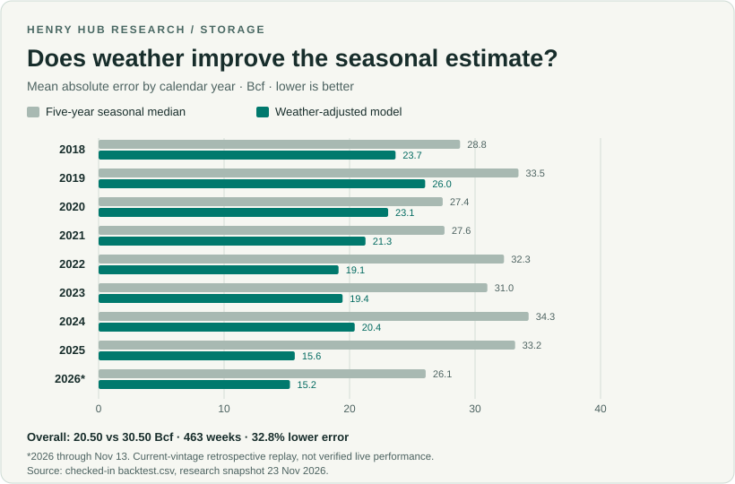

# Does observed weather improve weekly natural gas storage estimates?

**John Barreto · Research note 001 · 23 November 2026**

**Evidence status: retrospective nowcast replay using observed weather and current-vintage data.** This is not a verified live forecast record. The frozen edition had no completed scored live forecasts.

## Question and result

Can observed heating and cooling degree days improve an estimate of the EIA Lower 48 weekly net stock change relative to a simple seasonal benchmark?

In the checked-in chronological replay, the weather-adjusted model's mean absolute error (MAE) was 20.50 Bcf, compared with 30.50 Bcf for a five-year seasonal median, a relative reduction of 32.8%. Both methods are evaluated on the same 463 weekly dates, from 5 January 2018 through 13 November 2026. The model had lower MAE in each of the nine calendar-year groups; 2026 is incomplete.

| Calendar year | Weeks | Seasonal MAE (Bcf) | Model MAE (Bcf) | Relative reduction | Observed coverage of nominal 80% interval |
| :--- | ---: | ---: | ---: | ---: | ---: |
| 2018 | 52 | 28.81 | 23.67 | 17.9% | 57.7% |
| 2019 | 52 | 33.46 | 26.03 | 22.2% | 71.2% |
| 2020 | 52 | 27.42 | 23.07 | 15.9% | 82.7% |
| 2021 | 53 | 27.57 | 21.27 | 22.8% | 86.8% |
| 2022 | 52 | 32.31 | 19.12 | 40.8% | 80.8% |
| 2023 | 52 | 30.98 | 19.44 | 37.2% | 82.7% |
| 2024 | 52 | 34.27 | 20.41 | 40.4% | 76.9% |
| 2025 | 52 | 33.19 | 15.63 | 52.9% | 82.7% |
| 2026 (partial) | 46 | 26.07 | 15.25 | 41.5% | 82.6% |
| **All** | **463** | **30.50** | **20.50** | **32.8%** | **78.2%** |

MAE is the arithmetic mean of absolute errors in Bcf. Relative reduction is 100 × (1 − model MAE / baseline MAE). Coverage is the share of observations within the model's nominal 80% interval, including observations equal to either bound. The 78.2% aggregate coverage is 1.8 percentage points below that nominal target; it is not a confidence level for the MAE reduction. Year groups are by the target week's Friday. Annual reductions should not be averaged to obtain the overall reduction.

## Two weeks from the replay

Across all 463 weeks, the weather model was closer to the reported stock change on 266 and the seasonal median was closer on 197. Two weeks from the first winter show what those errors look like. Each value below is a withdrawal in billion cubic feet (Bcf), shown as a positive magnitude. The source CSV records withdrawals with a minus sign.

- **5 January 2018.** The Lower 48 withdrew 359 Bcf. The five-year median put the withdrawal at 158 Bcf, a miss of 201 Bcf. The model estimated 296.74 Bcf, a miss of 62.26 Bcf. Adjusting for weather captured part of the unusually large withdrawal.
- **2 February 2018.** The withdrawal was 119 Bcf. The seasonal median was already within 1 Bcf at 118. The weather adjustment moved the estimate to 101.5 Bcf and widened the miss to 17.5 Bcf.

## Method

The benchmark is the median of five previous seasonal analogs, using the Friday closest to the same month/day in each prior year. The model fits ordinary least squares to past deviations from that benchmark, with an intercept and two features: observed population-weighted HDD and CDD deviations from their respective five-year seasonal medians.

The rolling training window uses up to 156 previous eligible weeks, with a minimum of 104. The interval uses up to 104 earlier absolute replay errors, with a minimum of 52; the scored rows have an interval available. If n errors are available, sort their absolute values and choose the error at one-based rank min(n, ceil(0.8 × (n + 1))). The interval is the current estimate plus or minus that radius. Only prior errors enter this calculation, and the rolling, dependent time series does not establish a distribution-free coverage guarantee. The target week's reported inventory change is not included in its training data. The target is the change in published working-gas stocks, which may differ from implied physical flow because of reclassifications.

Sources are the EIA Lower 48 working gas series and NOAA CPC observed, population-weighted CONUS degree days, base 65°F. Weather is aggregated Friday through Thursday, an approximation to the inventory reference interval.

## What the evidence does and does not show

The result supports the usefulness of observed temperature exposure in this historical model. It does not establish that weather alone determines gas inventories or that model performance would be identical with data vintages actually available before each historical release. The source files may include historical revisions, and original release timing is not established for all weather observations. The result is a retrospective **nowcast replay**, not a test of forecast-weather accuracy or a verified live performance record. At the snapshot date the live ledger had no completed scored forecasts.

The calendar-year breakdown is descriptive, not an independent holdout test or a winter-only analysis. Interval coverage of 78.2% is empirical, not a guarantee. Further research should evaluate frozen first-release forecasts, regional inputs and winter-specific performance, alongside alternative drivers such as production, LNG feedgas and industrial demand.

## Evidence and reproduction

- [Frozen replay CSV (463 weeks)](https://github.com/NeuraX-JB/Henry-Hub-Futures-Curve-Explorer-How-the-Natural-Gas-Market-prices-winter/blob/ba3b94ba3a97c3262099da73a25a3a33f06c34ee/lab/storage/backtest.csv)
- [Model source at the snapshot](https://github.com/NeuraX-JB/Henry-Hub-Futures-Curve-Explorer-How-the-Natural-Gas-Market-prices-winter/blob/ba3b94ba3a97c3262099da73a25a3a33f06c34ee/lab/storage/model.py)
- [Recorded model state at the snapshot](https://github.com/NeuraX-JB/Henry-Hub-Futures-Curve-Explorer-How-the-Natural-Gas-Market-prices-winter/blob/ba3b94ba3a97c3262099da73a25a3a33f06c34ee/lab/storage/state.json)
- [Data provenance and definitions](../data/README.md)
- [Live storage dashboard](https://neurax-jb.github.io/Henry-Hub-Futures-Curve-Explorer-How-the-Natural-Gas-Market-prices-winter/lab/storage/)
- [Frozen evidence check and reproduction instructions](REPRODUCE.md)

This analysis is for research and education, not investment advice.

## Citation and edition

Barreto, John. “Does observed weather improve weekly natural gas storage estimates?” Research note 001, 23 November 2026. Evidence revision: `ba3b94ba3a97c3262099da73a25a3a33f06c34ee` in the canonical research repository. This standalone edition clarifies the presentation and methods without replacing the reported results. Cite the note date and evidence revision together; use the [snapshot record](../../SOURCE_SNAPSHOT.json) to distinguish evidence from later editorial changes.
